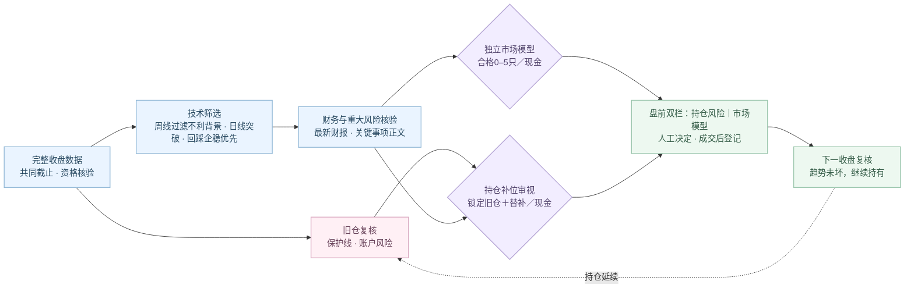

# A 股研究室 · A Share Lab

一组持续跟踪的组合，收盘后核验证据，下一交易日盘前由人决定。

当前代码的盘前报告与连续组合服务使用研究版 `continuous-signal-v5`：**不设强制到期卖出**，
趋势完整就继续持有；确认失效则提示退出，成交与可用现金确认后再评估替补。
它是本地优先的低频研究助手，不连接券商、不自动下单，也不是已经验证盈利的交易系统。

[当前策略合同](docs/CONTINUOUS_STRATEGY.md) · [候选风险初筛与人工审阅](docs/CANDIDATE_REVIEW.md) · [数据与许可](docs/DATA_POLICY.md) · [旧版完整归档](README_LEGACY.md)

[v5 修订与验证边界](docs/CONTINUOUS_V5_ACCEPTANCE.md) · [v4 历史实施核验](docs/CONTINUOUS_V4_ACCEPTANCE.md)。
v5为周线背景过滤、日线突破确认、日线回踩企稳优先；本地代码测试不代表云端切换或盈利验收。

新增：[马克斯周期风险层（影子运行）](docs/MARKS_CYCLE_SHADOW.md) · [免费数据超时与备用恢复](docs/FREE_DATA_RECOVERY.md)。
周期层只做本地对比，四类时点证据未齐时明确等待，不改变生产仓位；推送仍为精简文字。

## 从证据到下一次复核



## 入场、持有与补位

- 初次建仓与每只替补都须通过同一新入场门：**已完成周线排除明确下行/证据不足，完整日线确认底座突破**，
  优先等待同一突破位的日线回踩企稳；不再要求周线已经突破。周线整理/混合可以继续筛选，不冒充上涨。
  已确认企稳加排序分；当天真实确认的新突破仍为次选。接近突破、盘中瞬时穿越、回踩未站稳只观察。
- 周线背景与日线买点均合格时，底部区间扭转、`EARLY_UPTREND` 与未过度延伸的 `ORDERLY_UPTREND` 均可继续核验。
  早期位置只是小幅排名加分；“120 个交易日涨幅不超过 15%”不再一票否决。
  过度延伸、末端加速和抛物线上涨仍为硬排除。
- 技术筛选后，统一做**财务与重大风险核验**（`candidate-evidence-v2.0.0`）。
  取消全量公告逐条人工审批的独立门，核对最新财报、年度审计及可能改变财务结论的重大事项正文；
  普通制度修订、例行信息不因标题关键词直接拦截。担保、关联交易等需按实质证据判断，不因“例行”字样自动放行。
  资料获取失败只隔离对应个股，保留具体原因，不把未知当通过，也不阻断其他已核验候选。
  窄口径核验通过**不表示全面尽调、排除隐藏风险或未来收益稳定**。
  银行、保险缺行业适用专项指标时不套用工业企业阈值自动放行，也不因题材热度替代业绩证据。
- 结构保护距离是风险信息，不再仅因超过 8% 就否决新买；也不为了凑 8% 人为抬高结构线。
  合理买位、过度延伸、可成交性和组合风险门仍须满足，计划买价上限不是任意追价许可。
- 已持仓另设独立成本止损：确认成本 × 92%，触及即在盘前报告优先预警；结构先失效可更早退出。
  触线后反弹不自动解除警报，除权/分红待核验会明确报警；不是自动止损成交保证。
- 可启用[盘中一分钟风险监控](docs/INTRADAY_RISK_MONITOR.md)：只检查已确认持仓，成本触线或结构触线即尝试发 Server酱。
  结构触线不冒充收盘确认；行情过期/断线报警，推荐不视为成交。需要本机开机联网，不保证瞬时送达。
- 经使用者另行授权后，公司行动核验每天仅向巨潮资讯提交仍有效持仓的六位股票代码；
  不提交名称、成本、股数、金额、权重、入场日、组合编号或保护线。完整结果分为“无事件 / 已发现 / 未知”，
  任何超时、字段漂移或身份不一致都按未知处理，不会把未知冒充安全，也不会阻断整份盘前报告。
- 已持有股票不重新套用新买门，不因排名下降、进入成熟趋势或到期而自动换股。
  保护线只随已确认结构上移，同日重算、切换模型也不降低已有线。
- 组合为 **0–5 只**：所有合格的 1–5 股方案共同参与风险与收益比较，不优先凑成 3–5 股。
  1–2 股是有效的低敞口集中配置，不是只能在大组合失败后使用的过渡方案；无合格改善就留现金。
- 每行业最多一只；每个新建仓的单股总账户权重硬上限为 20%，以约 15% 为常态中枢，但不要求每只精确等于 15%。
  组合仍须通过适用的周期敞口、相关性、回撤、尾部风险和风险贡献等门；单股相关性以及
  1–2股组合的归一化单股风险贡献不作为分散门，程序明确标为不适用，并以低敞口和单股上限约束集中风险。
- 未确认的 `EXIT` 是条件预案，不是已成交；其资金不能成为正式新买依据。无合格替补或不优于现金就等。

## 仓位口径必须分清

| 对象 | 如何处理 |
|---|---|
| 已有持仓 | 按固定股数与现金重估真实漂移权重；不取整、不擅自再平衡 |
| 初次建仓 | 连续审计目标映射到 **股票仓内** 10% 档，再换算总账户权重并执行单股 20% 硬上限 |
| 新增单只替补 | 枚举 **总账户** 10%、20% 档，约 15% 只是研究中枢；仍受可用现金和全部风险门约束 |
| 报告 | 新买仓位标注总资金比例；未核定现金不写成“已空仓” |

真实权重需要完整、明确确认的 `account_snapshot`，不能只凭股票仓内比例猜现金。
快照、公司行动区间证据或持仓身份不完整时暂停补位；字段见[当前合同](docs/CONTINUOUS_STRATEGY.md#账户快照与证据)。

## 搜索范围与收益证据

初建从可用市场数据筛出周线背景合格的日线突破/回踩企稳候选，对排序前36个候选限时核对财务、公告和执行证据，再从通过者中，
用宽度128的近似搜索共同比较1–5股方案与现金基准；
不是全市场全部组合的穷举。后续单只补位则枚举本轮全部已合格替补及各新买档位，与现金一起比较。
当前基本面自动核验仅覆盖可由现有数据源核对的沪深 A 股；北交所尚未具备同等级证据接入，不应称为覆盖全部 A 股。
“固定旧仓，只补一只”与“所有股票、所有权重自由替换”是两个不同的问题。

报告单独保留最多5只排序靠前的技术研究候选，不让组合优化或现金决策隐藏已确认形态。
“重点候选”不是买入许可：财务、公告、可成交性待核验或组合风险不合格都会标明，不分配新买权重。
新核验链分别保存财务数值、官方清单、指定财报/重大事项正文及内容校验记录，但合成一个基本面风险结论；
**清单成功返回或没有风险关键词，不能代替所需正文证据**。
分页重叠需重新按日期取证，只有唯一公告数量与官方总数核对一致后才归一化；
冲突重复、身份错误、缺页和关键正文不足仍为未知，不能简单删重冒充完整。
该流程仍需真实连续运行验收，不能宣称已完成全自动专业尽调，也不能把待核验误称为没有强股。
财报期、数据源报告的公布日、公告清单发布时间、抓取时刻分别保存；尚未建成完整的历史更正链。“最新”指在决策时已披露的最新适用财报，
不是把当前修订报表倒填到过去。CSMAR 资产负债表快照不是完整利润、现金流或公告核验的替代。

当前排序用历史 20 交易日收益置信下界（LCB）代理，不是最高夏普，更不是未来最高收益。
连续持仓、真实成交、费用、分红和现金的账本另行记录；推荐或通知受理不能虚构成交与收益。
v2 数据库迁移不推断卖出、不自动清空任何活跃持仓；开源使用者必须在确认已空仓后显式记录 `cleared` revision。
本机这次切换已通过该显式空仓 revision 停用旧活跃跟踪；历史持仓、决策、通知和绩效审计不删除也不改写。
只有使用者下一次明确确认真实建仓，才创建新 revision、新 `position_key` 与隔离的连续追踪身份；
真实绩效链还必须从完整、明确确认的账户估值快照开始，不能由推荐或通知推测成交后自动生成。
严格的时点数据、成本、成交约束及公司行动一致的真实样本外验证尚未完成。单测通过不证明盈利。

## 安装与本地启动

需要 Python 3.12.x。仓库不包含合法授权的完整行情基线，空数据时不会编造推荐。

```bash
git clone https://github.com/zerongwong/a-share-lab.git
cd a-share-lab
python3.12 -m venv .venv
.venv/bin/python -m pip install --upgrade pip
.venv/bin/python -m pip install -e ".[dev]"
.venv/bin/ashare-lab
```

本地界面默认 `127.0.0.1:8501`。合法取得的 CSMAR 数据仅导入本机；
Tushare、BaoStock、AKShare 提供增量与核验适配，来源权限、更新时点和覆盖率仍须通过检查。

```bash
.venv/bin/ashare-import-csmar "/path/to/CSMAR-export" --as-of YYYY-MM-DD
.venv/bin/ashare-sync-daily
.venv/bin/python -m ashare_lab.cli.evening_report
.venv/bin/python -m ashare_lab.cli.company_actions authorize --yes
.venv/bin/python -m pytest
```

## 数据更新与微信

收盘后先分阶段同步，次日 06:30、07:30、08:00 再补齐并核验；08:18前收尾释放数据锁，08:18–09:00不启动新同步。
盘前报告在北京时间周一至周五08:20 首次尝试，08:30、08:40、08:50 有限重试；自动计算与提交窗口为08:20–08:58（不含08:58），目标09:00前收到。
独立截止检查在08:58、08:59运行，不争用主报告运行锁；正式计划未确认受理时提交当天已有部分结果、数据截止和缺项，观察候选不能冒称买入结论。
本机任务每60秒轻量唤醒，以北京时间时段去重后才启动业务，不受主机时区或夏令时影响；仍需电脑运行并联网，GitHub发布不等于云端部署或微信实际送达。
程序还必须确认当天是否交易日，节假日不按普通工作日猜测；只有上一完整交易日的共同截止和质量全部合格，才形成当天计划。
已记录受理的文字会去重；网络结果未知时可有限重试，不能保证第三方严格仅送达一次，也不把未知当作已送达。

日常微信仅保留盘前报告、15:30–16:00的已登记持仓盈亏日报，以及盘中/收盘退出风险和推荐生命周期完成复盘等已授权事件例外。
盘前无论是否持仓都单独计算全市场研究模型；现有持仓的风险复核另行显示。模型可能与持仓重叠，模型资金比例不等于账户可动用现金，也不会自动调仓。
持仓日报在15:35、15:45、15:55有限尝试，无有效登记持仓不虚构日报；数据同步、恢复和旧方案到期复盘只保留本地记录，不再单独推送。
持仓日报区分当日、累计与日均收益，并列自然日和交易日；日均采用累计÷交易日数，缺少持仓历程证据不编造。
原一分钟风险任务另在15:05–16:00补查收盘退出，失败持久重试；本机休眠、断网或第三方故障仍可能延迟。

默认仅用 Server 酱；盘前报告生产路径只发送精简文字和持仓预警，不上传或发送图片，也不需要
开通 Cloudflare R2。持仓文字披露与通道授权仍分别校验；历史图表配置仅为兼容保留。
密钥只存本机钥匙串；文字失败会按既有窗口重试并记录故障提醒。
**服务商受理不等于手机已收到**，定时任务也依赖本机运行与网络可用。

```bash
./scripts/install_daily_sync_launchagent.sh
./scripts/install_evening_report_launchagent.sh
```

安装计划任务需使用者主动执行。报告安装脚本会同时登记主报告、独立截止检查和持仓日报三个任务，失败恢复原任务；停止时统一卸载三个任务，不删除研究数据：

```bash
./scripts/uninstall_evening_report_launchagent.sh
```

完整历史安装及排障步骤保存在 [README 归档](README_LEGACY.md)。

## 推荐股票独立跟踪

自 2026-10-08 起，正式发布的买入推荐另外进入[生命周期跟踪](docs/RECOMMENDATION_TRACKING.md)：
不要求真实买入，不设持有到期日；记录模拟入场、信号退出、每股价差、持有交易日和日均收益。
连续重复推荐不重复计分，观察候选、未触发和证据缺失不冒充成交。已发送报告保留原始版本，
每日核验行情后更新。此账本与实际持仓收益及旧六期限组合隔离，复盘只提出线索，不自动修改规则。
另按用户要求统计“推荐日开盘→首个退出信号日收盘”的独立价格基准，新完成样本经授权后发送退出复盘。
迟发报告不追溯开盘，条件买点不视为已成交；原模拟执行账本仍保留，未指定模拟资金时仅报告元/股和元/股/日。

## 开发与兼容边界

核心模块：[入场合同](src/ashare_lab/analytics/continuous_signals.py)、[锁仓补位](src/ashare_lab/analytics/continuous_portfolio.py)、
[连续计划](src/ashare_lab/services/build_continuous_digest.py)、[独立净值记录](src/ashare_lab/services/continuous_strategy_journal.py)。
旧六期限及 MCP `generate_portfolio` 的 3–5 股搜索只保留为固定期限历史对照，不是当前连续组合生产入口；
冻结的历史推荐不改写；显式离线审计只可追加派生结算记录。自 2026-09-18 起，生产同步不再
结算、复盘或推送这些旧组合，
旧月度复盘也不再自动运行；当前新计划采用研究版 `continuous-signal-v5`。当前持仓为空时，
实际持仓追踪保持等待，直至使用者明确确认一次新的真实建仓后才建立新的持仓追踪身份；
独立推荐模拟跟踪不受这一实际建仓状态限制。
原始行情、账户快照、私有报告、数据库、密钥和签名图片地址不得提交 GitHub。
